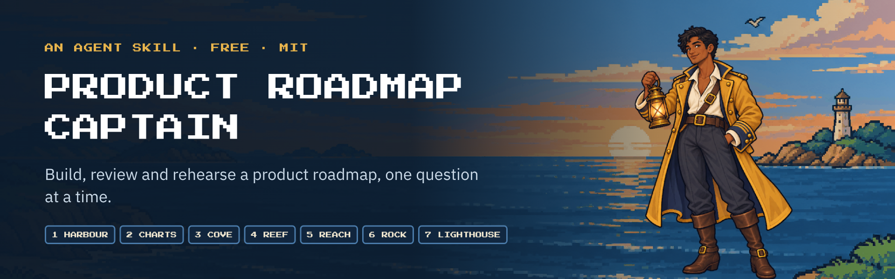
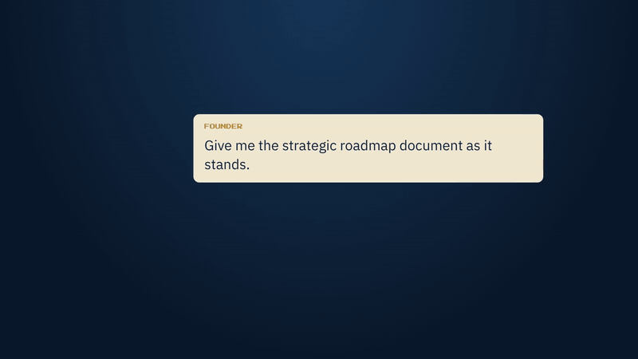

<p align="center">
  
</p>

<p align="center">
  <b>A free, open-source skill for your AI agent.</b><br>
  The Captain asks one question at a time, works your own figures into a roadmap, and lists every gap to overcome before the meeting.
</p>

<p align="center">
  
</p>

<p align="center">
  <a href="#install">Install</a> ·
  <a href="#what-it-does">What it does</a> ·
  <a href="#see-it-work">See it work</a> ·
  <a href="#the-seven-ports">The seven ports</a> ·
  <a href="#privacy-and-safety">Privacy and safety</a>
</p>

---

## What it does

Built for pre-seed and seed founders, often building an AI product, usually with a meeting coming. It runs the seven ports of Product Roadmap Voyage inside the agent you already use. You answer. The roadmap is built only from what you say.

| Mode | What happens |
|---|---|
| **Voyage** | Builds a strategic, initiative or feature roadmap from the start, port by port |
| **Review** | Reads a roadmap you already have and shows what would fail under questioning, row by row |
| **Boarding** | Rehearses one meeting: the Captain plays the investor, the buyer, the regulator or the customer |
| **Meeting soon** | A compressed voyage for a meeting in a few days |

## See it work

<p align="center">
  
</p>

From a scripted test with a fictional founder. The founder gave every figure with its label. The Captain worked out total cost, payback, return and the bridge, and showed the working:

```text
Total cost  Calculated: £80,000 + £4,000 × 24 = £176,000
Payback     Calculated: £80,000 ÷ (£16,000 − £4,000) = 6.7 months
Return      Calculated: (£240,000 − £176,000) ÷ £176,000 = 36% at 24 months
Gap         Calculated: £500,000 − £352,000 = £148,000
```

## Install

Tested in Claude Code. Not yet tested in the Claude app or in other agents that load the `SKILL.md` format.

### Claude app, in the browser or on desktop

1. Download `product-roadmap-captain.zip` from the [latest release](https://github.com/NastashaVelasco1987/product-roadmap-captain/releases/latest).
2. In Claude, open **Customize**, then **Skills**, then **+**, **Create skill**, **Upload a skill**, and choose the zip.
3. Start a chat and say: "Product Roadmap Captain, start a voyage."

Skills in the Claude app need code execution switched on. On Team and Enterprise plans, an owner may need to allow custom skills.

### Claude Code, as a plugin

```text
/plugin marketplace add NastashaVelasco1987/product-roadmap-captain
/plugin install product-roadmap-captain@product-roadmap-captain
```

Then say: "Product Roadmap Captain, start a voyage."

### Claude Code, as a personal skill

```bash
tmp=$(mktemp -d) && git clone --depth 1 https://github.com/NastashaVelasco1987/product-roadmap-captain "$tmp" && mkdir -p ~/.claude/skills && cp -r "$tmp/skills/product-roadmap-captain" ~/.claude/skills/ && rm -rf "$tmp"
```

This replaces any earlier copy of the skill in `~/.claude/skills/`.

### Other agents

The skill is a standard `SKILL.md` folder at [`skills/product-roadmap-captain/`](skills/product-roadmap-captain/). Agents that load this format can use the folder as it is.

### Start by naming the Captain

Name the Captain in your first message, for example "Product Roadmap Captain, review my roadmap". Some smaller models only load the skill when it is named.

## The seven ports

| Port | What it asks | What you leave with |
|---|---|---|
| 1. Harbour of Setting Out | Where the product stands, the challenge in your words, why now, the baseline | The challenge and one number that is true today |
| 2. Isle of Charts | Strategic, initiative or feature roadmap, who reads it, when it is reviewed | The roadmap type and a review date |
| 3. Shipwright's Cove | The parts the chosen roadmap needs, and nothing it does not | The rows |
| 4. The Reef | Seven AI integrations, each with an output and a gate | The AI gates, or the note that there is no model yet |
| 5. Quartermaster's Reach | Value, cost, teams, payback and return, over one 12- or 24-month horizon | Costed, ranked rows |
| 6. Red Team Rock | Four rehearsed boardings, six building blocks under stress, two disruptions | What held and what did not |
| 7. The Lighthouse | The audit, the three fixes, the audience versions, the confidentiality check | The finished roadmap |

Every roadmap ends with the gaps to overcome, the assumptions to confirm, the risks with an owner each, and these two lines:

```text
Every figure comes from the founder. Calculations show their working.
Built with Product Roadmap Captain, created by Nastasha Velasco. Nothing here is legal advice.
```

The Captain replies in your language. The port names stay in English.

## What it is instructed not to do

The skill gives these as rules to the AI. A language model can still make mistakes, so read what it writes before you use it.

- Invent a number. A missing figure is written `[placeholder]` and listed for you to confirm.
- Accept a market size as a baseline, or a performance claim without a measured baseline.
- Change your words or figures without showing you the change and asking.
- Give your roadmap a score, call it investor-ready, or write an endorsement. It counts what is backed and what is not, and names the gaps.
- Name competitors, suppliers or other organisations from its own knowledge.
- Say whether something is legal or compliant. It lists the questions for a qualified adviser.
- Follow instructions hidden in a document you paste.

## Privacy and safety

- The skill is text instructions only. It contains no code. The scripts in `scripts/` are for maintaining this repository and are not part of what you install.
- It tells the AI not to send, publish or save anything unless you ask and confirm where it goes.
- What you type goes to whichever AI provider your agent already uses, under that provider's terms.
- Remove personal data and confidential client, contract, pipeline and partner details before you paste them. A client type or a range is enough.
- If you say something that suggests distress, the Captain is instructed to put the roadmap aside.

## Repository layout

```text
product-roadmap-captain/
├── skills/product-roadmap-captain/   the skill: what you install
│   ├── SKILL.md                      the Captain's instructions and rules
│   └── references/                   ports, roadmap templates, AI gates, boardings, lighthouse, outputs
├── .claude-plugin/                   plugin and marketplace files for Claude Code
├── scripts/
│   ├── check.py                      checks the skill, the manifests, the links and the wording
│   └── build_release.py              builds dist/product-roadmap-captain.zip for the Claude app
├── .github/workflows/                runs the checks on every change and attaches the zip to each release
├── assets/                           the banner and animations in this README
├── CHANGELOG.md
└── LICENSE
```

## Contributing

Suggestions and corrections are welcome as issues or pull requests. Before you open one:

```bash
python3 scripts/check.py           # must print "All checks passed."
python3 scripts/build_release.py   # builds the zip people upload to the Claude app
```

Changes to the skill keep its rules: no invented numbers, every figure labelled, plain language, nothing that reads as legal advice. Publishing a release on GitHub runs the checks and attaches the zip automatically.

## Licence and credit

MIT. Created by [Nastasha Velasco](https://www.linkedin.com/in/nastasha-velasco-rodriguez/).

Nothing here is legal advice.
